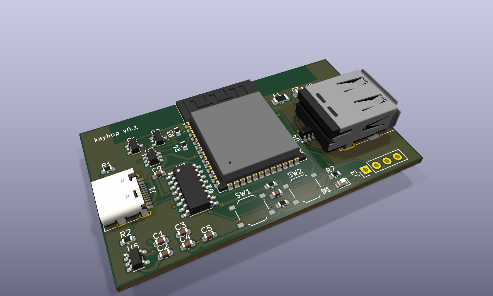

# keyhop PCB: minimal version design notes

Status: **board v0.1 laid out, routed and checked; JLCPCB files generated. Not yet ordered or tested on hardware.** Target fab and assembly: JLCPCB, 2-layer board, 60 × 35 mm.

## Files

| File | What it is |
|---|---|
| `keyhop.kicad_pro` | KiCad project (holds net classes and design rules) |
| `keyhop.kicad_sch` / `keyhop-schematic.pdf` | Schematic |
| `keyhop.kicad_pcb` | Routed board |
| `fab/keyhop-gerbers.zip` | Gerbers and drill files (separate PTH/NPTH) for JLCPCB |
| `fab/keyhop-bom.csv` | Parts list in JLCPCB format (Comment, Designator, Footprint, LCSC Part #) |
| `fab/keyhop-cpl.csv` | Placement file in JLCPCB format (Designator, Mid X, Mid Y, Layer, Rotation) |
| `renders/` | 3D renders (top, bottom, perspective) |

## Board v0.1 summary

- **Size:** 60 × 35 mm, grown from the planned 50 × 30 mm. The ESP32 footprint's antenna keep-out (no copper in the top 6.75 mm across 48 mm) plus the 15.6 mm USB-A footprint didn't leave enough room at 50 × 30.
- **Placement:** ESP32 in the middle with the antenna flush to the top edge. USB-C, ESD, CH340C and auto-reset on the left; USB-A, fuse and ESD on the right; regulator bottom-left; RESET/BOOT buttons under the module; LED and the unassembled UART header bottom-right.
- **Routing:** Freerouting 2.5.0 autorouter. Power nets (+5V, +3V3, GND, /VBUS_A) are 0.5 mm, necking to 0.375 mm into small pads. Signals are 0.25 mm, necking to 0.187 mm at fine-pitch pads. 42 vias (0.6/0.3 mm, power 0.8/0.4 mm). GND pour on both layers.
- **Rules,** set to JLCPCB 2-layer standard capability with margin: min track 0.15 mm, clearance 0.2 mm, min hole 0.3 mm, copper to edge 0.3 mm.
- **Changes from the stock footprints:** the ESP32 module's GND-pad thermal vias were enlarged from 0.2 mm to 0.3 mm (JLCPCB's standard minimum hole). J1 and J2 connect solidly to the GND pour (no thermal relief).
- **Checks (2026-11-16):** DRC reports 0 errors, 0 unconnected items, 0 schematic mismatches. The remaining warnings are cosmetic silkscreen ones (labels touching pads or the edge; JLCPCB clips silkscreen off pads) plus "U1 differs from library" (the via change above). ERC has one expected error, explained below.
- **Silkscreen:** R5, C6 and R6 labels are hidden (no room). Parts are placed from the CPL file, not the labels.

## Ordering at JLCPCB

1. Upload `fab/keyhop-gerbers.zip`. Defaults are fine: 2 layers, 1.6 mm, HASL or ENIG.
2. Turn on **PCB Assembly** (top side), then upload `fab/keyhop-bom.csv` and `fab/keyhop-cpl.csv`.
3. **Check part rotations in JLCPCB's placement preview.** KiCad and JLCPCB define 0° differently for some packages, most often the SOT-23/SOT-23-5/SOT-23-6 parts, the CH340C (SOIC-16), the ESP32 module and the USB connectors. Fix any that look wrong in the preview; pin 1 markers must line up.
4. J3 (the UART header) isn't assembled. It's excluded from the BOM and CPL.
5. Recheck stock for each LCSC number. Extended parts (the ESP32, USB connectors, ESD chips) add a per-part setup fee.

## ERC note

ERC shows one expected error, U2 V3 and U5 VOUT ("two power outputs joined"). The CH340C datasheet requires V3 tied to VCC at 3.3 V, so right-click the marker and choose **Exclude**.

## 3D models

KiCad's library has no 3D models for J1 (HRO TYPE-C-31-M-12), J2 (XKB U231-091N-4BLRA00-S) or SW1/SW2 (XKB TS-1187A). The renders use stand-ins for the two USB sockets (GCT USB4105 and Molex 67643) on a render-only copy; the buttons show as outlines. This doesn't affect the board or the order files.

## Circuit

- **MCU:** ESP32-S3-WROOM-1-N8. The firmware doesn't use PSRAM.
- **USB-C (J1):** supplies power, flashing and serial logs.
  - VBUS goes to the +5V rail.
  - CC1 and CC2 each have a 5.1k resistor to GND.
  - D+/D− go through a USBLC6-2SC6 (U3) to a CH340C (U2).
- **CH340C (U2):** runs at 3.3V, with VCC and V3 both tied to +3V3, so its logic levels are safe for the ESP32.
  - CH340C TXD goes to ESP RXD0 (IO44). CH340C RXD comes from ESP TXD0 (IO43).
  - DTR/RTS drive the standard esptool auto-reset circuit, built from two NPN transistors (MMBT3904) with 10k base resistors:
    - Q1: base from DTR, emitter to RTS, collector to EN.
    - Q2: base from RTS, emitter to DTR, collector to IO0.
- **EN:** 10k pull-up to 3V3, 1µF to GND, RESET button to GND.
- **IO0:** 10k pull-up, BOOT button to GND.
- **USB-A host port (J2):** D−/D+ go to IO19/IO20 through a second USBLC6-2SC6 (U4).
  - VBUS_A comes from +5V through a 500 mA polyfuse (F1), with 22µF and 100nF capacitors to GND.
- **Regulator (U5):** AP2112K-3.3. VIN and EN both connect to +5V. 1µF input and output capacitors, plus 10µF on each of +5V and +3V3, and 100nF at the module's 3V3 pin.
- **LED:** goes from +3V3 through 1k to the green LED, then to IO38. It is active-low, so it matches `BOARD_OLIMEX` and the firmware runs unchanged.
- **UART test header (J3, not assembled):** 1×4 at 2.54 mm with 3V3, TX (ESP TXD0), RX (ESP RXD0) and GND. It's a fallback for flashing and logs if the CH340C side fails.
- **Unused pins:** leave the IO3, IO45 and IO46 strapping pins floating. All other unused GPIOs carry no-connect flags.
- **Power budget:** the 5.1k CC resistors only request default USB power, about 500 mA from a computer port, shared by the ESP32 (up to ~350 mA in radio bursts) and the keyboard. A phone charger is fine. A heavy RGB keyboard on a laptop port may hit the limit.

## Layout notes

- Put the module's antenna end at the board edge. Keep copper, ground pour and traces out of the antenna keep-out area on both layers.
- Put USB-C and USB-A on opposite short edges. Route D+/D− as short, matched-length pairs.
- Place the ESD chips close to each connector.

## JLCPCB / LCSC parts

Each part's LCSC number is stored in the schematic as an `LCSC` field. All numbers were checked on lcsc.com on 2026-11-16, and the part names matched. Stock and JLCPCB Basic/Extended status change, so recheck on jlcpcb.com before ordering.

| Ref | Part | Footprint | LCSC |
|---|---|---|---|
| U1 | ESP32-S3-WROOM-1-N8 | RF_Module:ESP32-S3-WROOM-1 | C2913198 |
| U2 | CH340C | SOIC-16 | C84681 |
| U3, U4 | USBLC6-2SC6 | SOT-23-6 | C7519 |
| U5 | AP2112K-3.3TRG1 | SOT-23-5 | C51118 |
| J1 | HRO TYPE-C-31-M-12 | USB_C_Receptacle_HRO_TYPE-C-31-M-12 | C165948 |
| J2 | XKB U231-091N-4BLRA00-S (USB-A female, SMD) | USB_A_Receptacle_XKB_U231-091N-4BLRA00-S | C2880618 |
| J3 | 1×4 pin header (not assembled) | PinHeader_1x04_P2.54mm_Vertical | n/a |
| F1 | Littelfuse 1206L050YR, 500 mA hold, 6 V | Fuse_1206_3216Metric | C163512 |
| Q1, Q2 | MMBT3904 | SOT-23 | C20526 |
| SW1, SW2 | XKB TS-1187A-B-A-B (RESET, BOOT) | SW_Push_1P1T_XKB_TS-1187A | C318884 |
| D1 | Everlight 19-217/GHC green LED | LED_0603_1608Metric | C72043 |
| R1, R2 | 5.1k 0603 | R_0603_1608Metric | C23186 |
| R3–R6 | 10k 0603 | R_0603_1608Metric | C25804 |
| R7 | 1k 0603 | R_0603_1608Metric | C21190 |
| C5, C8, C9 | 100nF 0603 | C_0603_1608Metric | C14663 |
| C1, C3, C6 | 1µF 0603 | C_0603_1608Metric | C15849 |
| C2, C4 | 10µF 0603 | C_0603_1608Metric | C19702 |
| C7 | 22µF 0805 | C_0805_2012Metric | C45783 |
