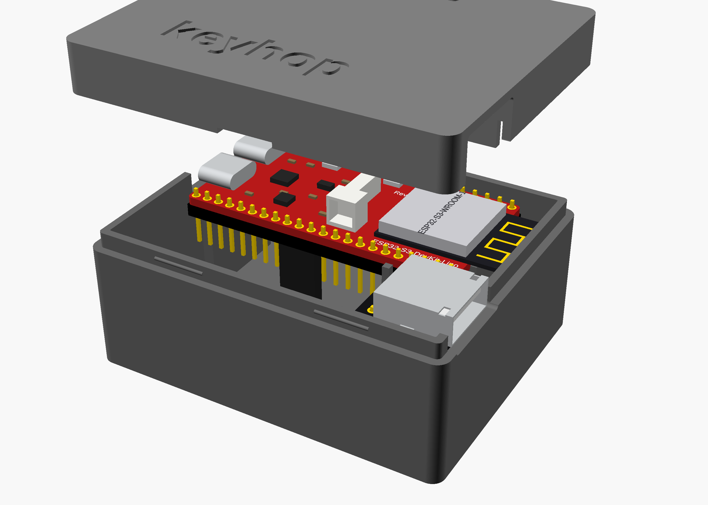
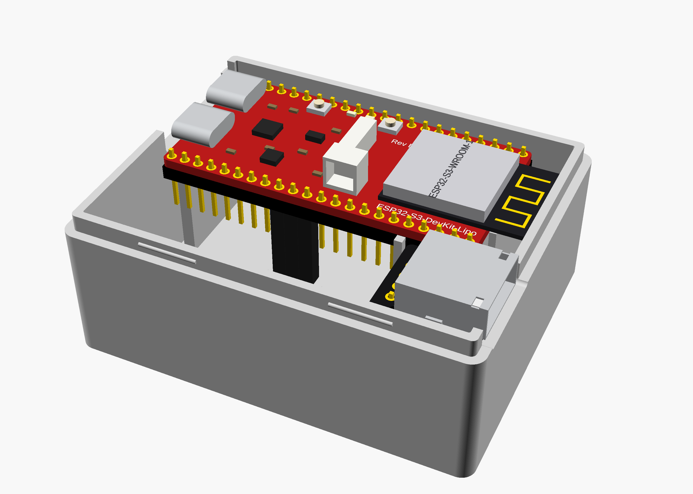
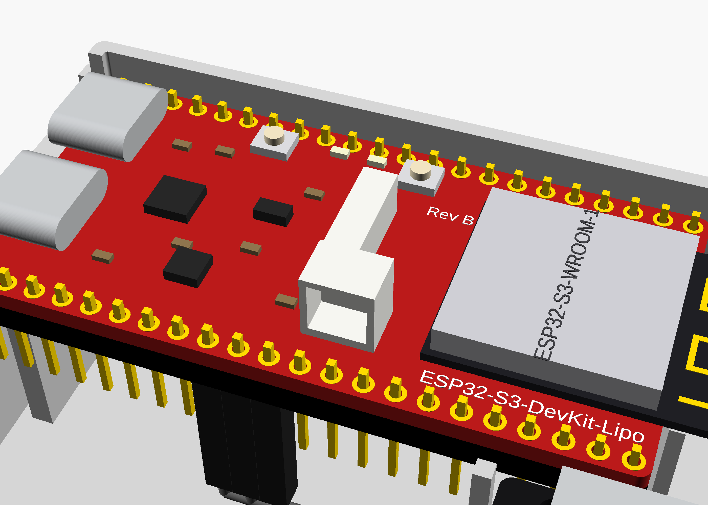
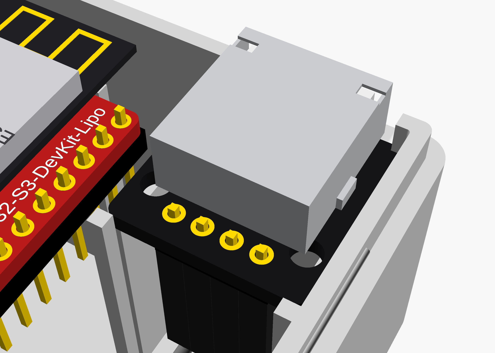
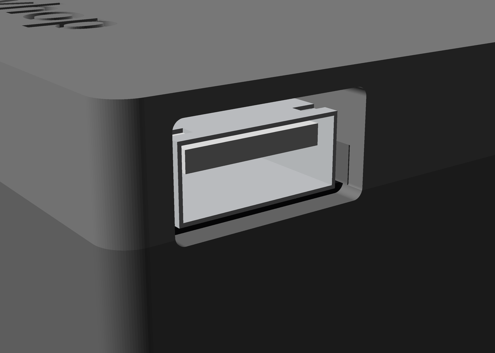

# keyhop proto case

A 3D-printed box for the no-solder build: an **Olimex ESP32-S3-DevKit-LiPo** and a
**Pi Hut USB-A breakout (horizontal)**, joined by female-female jumper wires.

With the boards inside (lid off; boards are simple stand-in blocks: red = Olimex, dark = USB-A breakout, black = jumper housings):

The Olimex close up:

The USB-A breakout close up, inside and from outside:

- Outside size about 70 × 55 × 33 mm, with 3 mm walls (MJF needs at least 1 mm everywhere, including beside the snap grooves). Most of the height is the space under the boards
  for the jumper wires.
- Both boards sit right side up with their pins pointing down. The Olimex rests on two
  blocks under its short ends, and the breakout on two strips under its sides. Posts and a
  fin on the lid hold both boards down and apart.
- Openings: both Olimex USB-C ports (one slot) on one end, the USB-A socket on the other,
  and a window in the lid over the Olimex LEDs and buttons.
- Snap-fit lid (same lap joint as `../enclosure/`), with a fingernail notch on the front.

## Files

| File | What it is |
|---|---|
| `keyhop-proto-case.scad` | OpenSCAD source; every dimension is a named value at the top |
| `keyhop-proto-case-base.stl` | Base, ready to print |
| `keyhop-proto-case-lid.stl` | Lid, flipped for printing |
| `renders/` | Pictures (`case-inside-*.png` show the boards in the base) |

## Check before printing

Dimensions marked "photo" in the `.scad` were estimated from phone photos with a ruler
(about ±1 mm). Most likely to need a tweak once printed:

- `under` (21 mm): room under the boards for the header plastic, jumper housings and the
  wire bend.
- `usbc_y`: where the two USB-C ports sit along the Olimex edge.
- `win`: where the LED/button window sits.
- USB-A breakout size (`br_l`, `br_w`) and socket size.

## Build (nuc)

OpenSCAD on nuc is the snap's **2026.11-RC0** (`latest/candidate` channel, updated 2026-11-20 from 2021.01). The snap can't write to `/tmp`, so work in the home folder:

    openscad -D 'part="base"' -o keyhop-proto-case-base.stl keyhop-proto-case.scad
    openscad -D 'part="lid_print"' -o keyhop-proto-case-lid.stl keyhop-proto-case.scad
    openscad -D 'part="collisions"' -o c.stl keyhop-proto-case.scad   # should be empty

Pictures (2800 × 2000, smooth curves, in colour; run under `xvfb-run -a -s '-screen 0 3000x2200x24'`):

    openscad --backend=Manifold --render -D '$fn=128' -D 'part="inside"' --colorscheme=Tomorrow \
        --imgsize=2800,2000 --camera=33,26,12,50,0,25,210 -o renders/case-inside-top.png keyhop-proto-case.scad

Other views: `part="exploded"` with `--camera=35,25,20,58,0,30,230`, `part="assembly"` with
`35,25,15,60,0,215,200`, `part="inside"` with `33,26,12,55,0,320,210` (case-inside-usba.png) `56,10,24,40,0,300,70` (case-usba-closeup.png) and `30,35,24,45,0,20,105` (case-olimex-closeup.png),
`part="assembly"` with `110,-25,45,64,9,26` (case-usba-outside.png).
The `libEGL ... Permission denied` warnings are harmless (software rendering).

The STLs in this folder were exported with the old 2021.01 and are what was ordered on 2026-11-20.

The collision check only finds flat contact (boards resting on supports) as of 2026-11-20.
